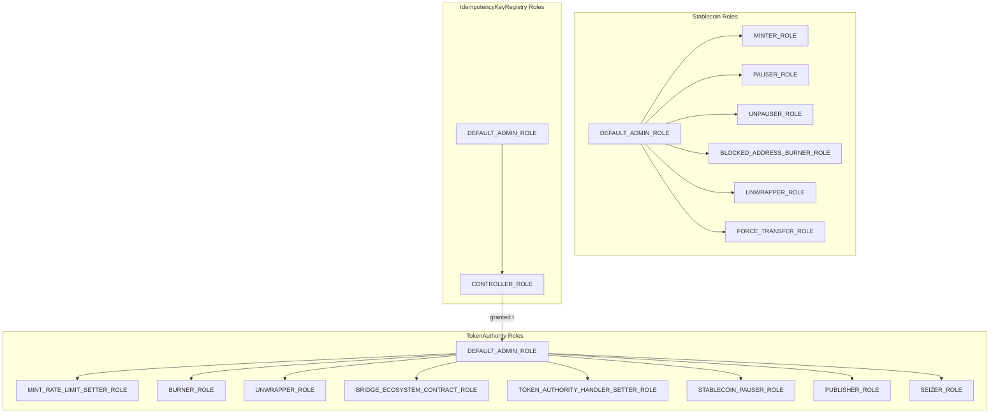
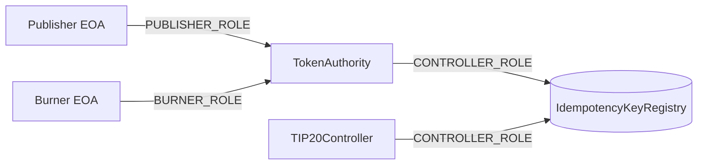
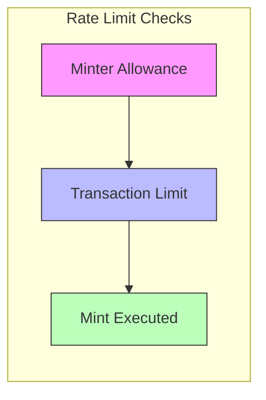
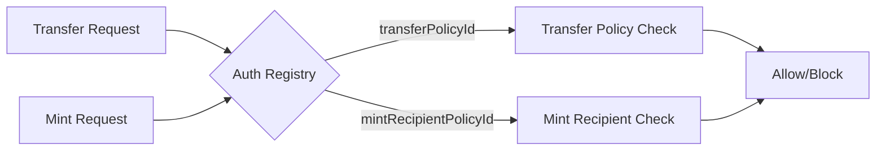

# Access Control

## Role Hierarchy

The same role set applies to `TIP20Controller`, which shares the `IdempotencyKeyRegistry` with `TokenAuthority`.

## Stablecoin Roles

### `DEFAULT_ADMIN_ROLE`
Full administrative control over the stablecoin.

| Permission | Function |
|------------|----------|
| Set max supply | `setMaxSupply(uint256)` |
| Set transfer policy | `setTransferPolicyId(uint64)` |
| Set mint recipient policy | `setMintRecipientPolicyId(uint64)` |
| Complete migration | `completeMigrationToWrapped()` |
| Upgrade implementation | `upgradeToAndCall(address, bytes)` |
| Manage roles | `grantRole()`, `revokeRole()` |

### `MINTER_ROLE`
Token minting and burning operations.

| Permission | Function |
|------------|----------|
| Mint tokens | `mint(address, uint256)` |
| Burn tokens | `burn(uint256)` |
| Unwrap tokens | `unwrap(address, uint256)` |

Note: `mint()` is disabled after `completeMigrationToWrapped()` is called.

### `PAUSER_ROLE`
Emergency pause capability.

| Permission | Function |
|------------|----------|
| Pause transfers | `pause()` |

### `UNPAUSER_ROLE`
Resume normal operations.

| Permission | Function |
|------------|----------|
| Unpause transfers | `unpause()` |

### `BLOCKED_ADDRESS_BURNER_ROLE`
Force-liquidate blocked addresses.

| Permission | Function |
|------------|----------|
| Burn blocked balances | `burnFromBlockedAddress(address)` |

### `UNWRAPPER_ROLE`
Convert stablecoins back to reserve tokens.

| Permission | Function |
|------------|----------|
| Unwrap tokens | `unwrap(address, uint256)` |

### `FORCE_TRANSFER_ROLE`
`StablecoinTemplateV3` only (not `ReserveLedger`). Grant it **only to the TokenAuthority's `ForceTransferSeizeHandler`**, which only the TokenAuthority can call, after it has checked the Seizure Wallet list. The coin cannot enforce who holds it, so the readiness check confirms `getRoleMemberCount(FORCE_TRANSFER_ROLE) == 1`.

| Permission | Function |
|------------|----------|
| Move coins out of a blocked address | `forceTransfer(address, address, uint256)` |

## TokenAuthority Roles

### `DEFAULT_ADMIN_ROLE`
Full administrative control over TokenAuthority.

| Permission | Function |
|------------|----------|
| Set whether keys are required on `mint` | `setIdempotencyKeysVersion(IdempotencyKeysVersion)` |
| Migrate idempotency-key registry | `setIdempotencyKeyRegistry(address)` |
| Manage roles | `grantRole()`, `revokeRole()` |
| Upgrade implementation | `upgradeToAndCall(address, bytes)` |

### `MINT_RATE_LIMIT_SETTER_ROLE`
Configure minting rate limits.

| Permission | Function |
|------------|----------|
| Set minter allowance | `setMinterAllowance(address, address, uint256)` |
| Set transaction limit | `setTxnMintLimit(address, uint256)` |

### `BURNER_ROLE`
Initiate token burns through TokenAuthority.

| Permission | Function |
|------------|----------|
| Burn tokens | `burn(address, uint256)` |
| Burn, marking keys used | `burn(address, uint256, bytes32[])` |

### `PUBLISHER_ROLE`
Retire idempotency keys without a token movement. Each call forwards to the shared `IdempotencyKeyRegistry`; the TokenAuthority itself must hold `CONTROLLER_ROLE` there.

| Permission | Function |
|------------|----------|
| Mark keys used | `useKeys(bytes32[])` |

### `STABLECOIN_PAUSER_ROLE`
Pause a single stablecoin's mint/burn/wrap/unwrap paths.

| Permission | Function |
|------------|----------|
| Pause or unpause a stablecoin | `setStablecoinPaused(address, bool)` |

### `UNWRAPPER_ROLE`
Initiate unwrapping through TokenAuthority.

| Permission | Function |
|------------|----------|
| Unwrap tokens | `unwrap(address, address, uint256)` |

### `BRIDGE_ECOSYSTEM_CONTRACT_ROLE`
Trusted contracts that bypass rate limits.

| Permission | Function |
|------------|----------|
| Mint without limits | `mintBridgeEcosystem(address, address, uint256)` |

### `TOKEN_AUTHORITY_HANDLER_SETTER_ROLE`
Configure token handlers.

| Permission | Function |
|------------|----------|
| Set handler | `setTokenHandler(address, address)` |
| Register stablecoins | `registerStablecoin(address, address, address, uint256)` |
| Unregister stablecoins | `unregisterStablecoin(address)` |

### `SEIZER_ROLE`
`keccak256("SEIZER_ROLE")`, on both `TokenAuthority` and `TIP20Controller`. Grant it only to the entity's Seize Authority vault. The readiness check confirms it is the sole member via `getRoleMemberCount` / `getRoleMember`.

| Permission | Function |
|------------|----------|
| Seize from a frozen holder to a listed Seizure Wallet | `seize(address, address, address, uint256)` |

Seize settings are `DEFAULT_ADMIN_ROLE` only: `setSeizureWalletPolicyId(uint64)` on both controllers (one list for the whole controller, checked against a fixed registry: the seize handlers' AuthRegistry on `TokenAuthority`, TIP-403 on `TIP20Controller`), and on `TokenAuthority` `setSeizeHandler(address, address)` for stablecoins registered without a seize handler. New stablecoins get their seize handler from `registerStablecoin`.

### Roles stablecoins grant for seize

Granted by the stablecoin's admin during setup. Seize handlers are called only by the TokenAuthority's `seize`; token handlers and the TokenAuthority never use these roles.

| Stablecoin | Held by | Roles |
|---|---|---|
| `StablecoinTemplateV3` | `ForceTransferSeizeHandler` | `FORCE_TRANSFER_ROLE` |
| `StablecoinTemplateV2` | `BurnAndRemintSeizeHandler` | `BLOCKED_ADDRESS_BURNER_ROLE`, `MINTER_ROLE`, `UNBLOCKER_ROLE`, `BLOCKER_ROLE`, `PAUSER_ROLE`, `UNPAUSER_ROLE`; mint recipient: the Seizure Wallet and the seize handler |
| TIP-20 | TIP20Controller | `BURN_AT_ROLE`, `PAUSE_ROLE`, `UNPAUSE_ROLE` (plus the existing `ISSUER_ROLE`) |

## IdempotencyKeyRegistry Roles

One registry is shared by every controller deployment so that keys are single-use across all of them, not once per controller.

### `DEFAULT_ADMIN_ROLE`
Controls which controllers may share the key namespace.

| Permission | Function |
|------------|----------|
| Authorize / de-authorize a controller | `grantRole()`, `revokeRole()` |
| Upgrade implementation | `upgradeToAndCall(address, bytes)` |

### `CONTROLLER_ROLE`
Held by each controller contract (`TokenAuthority`, `TIP20Controller`) — never by an EOA. Controllers gate their own callers with `PUBLISHER_ROLE` / minter allowance / `BURNER_ROLE` before forwarding here.

Any controller with `CONTROLLER_ROLE` may mark a still-free key used. Uniqueness is registry-wide.

| Permission | Function | Additionally requires |
|------------|----------|-----------------------|
| Mark keys used | `useKeys(bytes32[])` | every key free and nonzero |

Granting this role is what admits a controller into the shared namespace:

Revoking `CONTROLLER_ROLE` from a controller halts all of its key operations while leaving existing key state intact.

## Rate Limiting

TokenAuthority enforces three-level rate limiting for minting:

| Level | Scope | Configuration |
|-------|-------|---------------|
| Minter Allowance | Per-user, per-stablecoin | Decrements with each mint |
| Transaction Limit | Per-stablecoin | Max amount per mint call |

## Auth Registry Integration

External policy-based access control:

| Policy | Purpose |
|--------|---------|
| `transferPolicyId` | Validates sender/recipient for transfers |
| `mintRecipientPolicyId` | Validates recipients for minting |

Blocked addresses cannot send or receive tokens. The `burnFromBlockedAddress()` function uses transient storage to temporarily bypass this restriction during force-liquidation.
